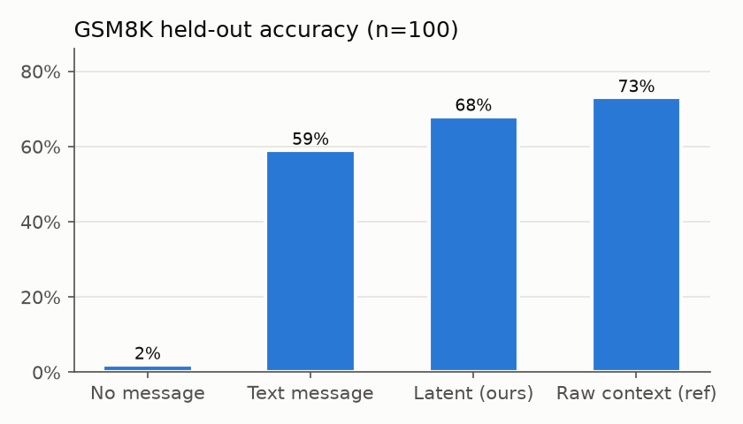
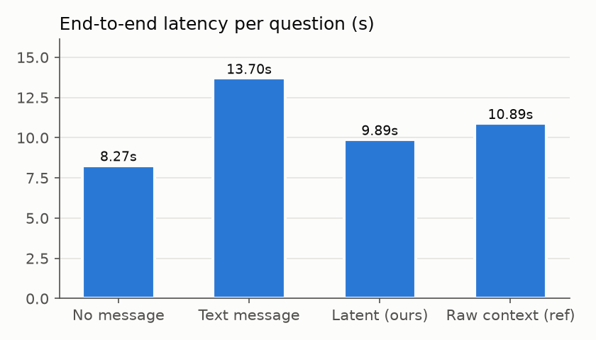
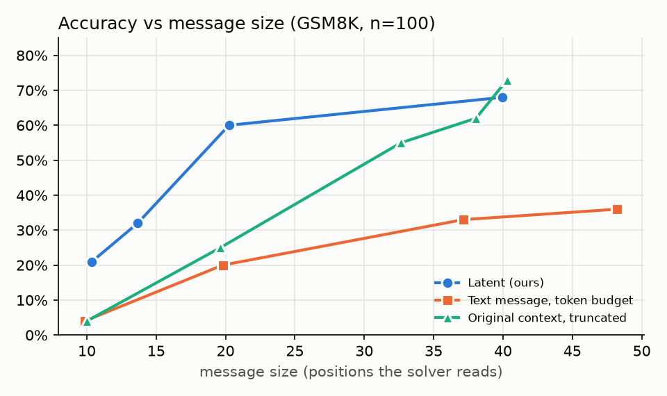
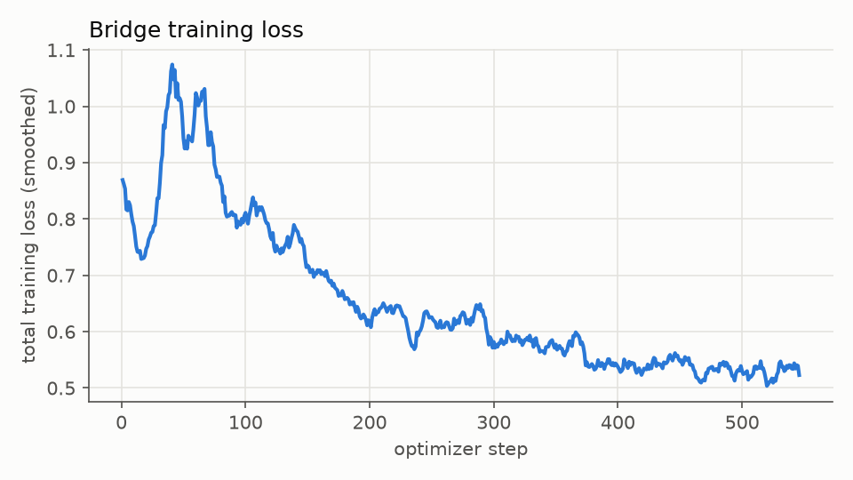

# LatentBridge

**Small Llama agents that talk in vectors instead of text.**
Built for the Meta Global AI Developer Hackathon (track: *Push the Frontier*).

**The idea.** Small models will always make some mistakes. But small specialists that are good at different
things should be able to work together *like one model*, sharing what they understood instead of
squeezing it through a written summary. LatentBridge lets them do that on consumer hardware.

Multi-agent LLM systems pass messages as text: one model writes a message token by token, the next model
reads it back. LatentBridge replaces that text channel with a learned **latent channel**. The reader model
reads its input once, and a small trained *bridge* maps the reader's hidden states straight into the
solver's input-embedding space as **soft tokens**. The reader never decodes a single token. Both LLMs stay
frozen; only the bridge (17M params) trains.

```
            Muse Spark (Meta Model API)            plans the task, routes subtasks
                    │
        facts ──────┴────── question
          │                    │
 Llama 3.2 1B (reader)         │
   one forward pass            │
          │ layer-8 hidden states
   ┌──────▼──────┐             │
   │   Bridge    │ soft tokens │
   └──────┬──────┘             │
          └──────► Llama 3.2 3B (solver) ──► answer
```

Text pipeline for comparison: the 1B *writes* a ~60-token message, the 3B reads it.

## Meta models used

| Model | Role |
|---|---|
| **Muse Spark** (`muse-spark-1.1`, Meta Model API) | Orchestrator: splits each task into reader/solver subtasks (~2.5 s, ~760 tokens per plan, cached) |
| **Llama 3.2 1B Instruct** (`meta-llama/Llama-3.2-1B-Instruct`) | Reader / sender, 4-bit NF4 |
| **Llama 3.2 3B Instruct** (`meta-llama/Llama-3.2-3B-Instruct`) | Solver / receiver, 4-bit NF4 |

Everything runs on a laptop **RTX 3050 with 4 GB VRAM** (both models + bridge ~3.2 GB at inference;
training capped at 3.9 GB).

## How it works

**Task.** GSM8K word problems. Each question is split into *context* (all sentences but the last) and
*final question* (last sentence). The reader sees only the context; the solver sees only the final question
plus the reader's message, then reasons in a few steps and ends with `#### <number>`. The solver can only
succeed if the message carries the facts.

**Bridge** (`bridge.py`, `TokenBridge`). One soft token per context token (or per `stride` tokens, which
compresses the message). The reader's layer-8 hidden states are standardized per dimension, then

```
soft_token = normalize( Linear(h)  +  0.1 · Residual(h) ) · mean_embedding_norm
```

- **Linear** is initialized in closed form (`fit_ridge.py`): ridge regression from the reader's hidden states
  to the solver's embedding of the *same* token. Llama 3.2 1B and 3B share one tokenizer, so this target
  exists for free. On held-out tokens the fit reaches cosine 0.72 and recovers the exact token 80% of the time.
- **Residual** (MLP + causal self-attention) starts at zero and learns what the linear map misses.

**Training** (`train.py`). Both LLMs frozen. Loss = KL distillation from a teacher (the 3B reading the
original context, temperature 2) + 0.5 × CE on the gold solution + CE for *reconstructing* the context from
the latents + 0.2 × cosine alignment to the token embeddings. AdamW 2e-5, wd 0.01, grad clip 1.0,
batch 1 × 8 accumulation, gradient checkpointing through the frozen 4-bit receiver. Reader hidden states are
cached once (`build_dataset.py`), so training keeps only the 3B on the GPU.

**Validation that cannot be fooled.** Besides the losses, every epoch reports
(1) the *shuffle gap*: solution loss when the solver gets **another problem's** latents minus the loss with
the right latents (≈0 means the message carries nothing problem-specific), and
(2) accuracy of the solver's own free-running answers on 20 validation problems.

## What did not work: the Perceiver bridge collapses

The original plan used a Perceiver-style resampler (K=16 learned queries cross-attending to the reader's
states). It trained smoothly and its teacher-forced token accuracy rose from 65% to 73%, but **free-running
accuracy was 0/10**. Diagnosis (`debug_latent.py`):

- Its outputs were nearly identical for every input (cosine 0.994–0.999 between different problems), and
  another problem's latents worked as well as the right ones (shuffle gap ≈ 0). The solver received a generic
  "here is a math problem" prompt and invented the numbers.
- Cause: LLM hidden states are strongly anisotropic. Mean-pooled reader states of two unrelated problems have
  cosine 0.85 (≈0 after per-dimension standardization), and ~40 of the input states were the fixed instruction
  prompt, which is identical for every input under causal attention. A generic soft prompt is the easiest
  way to lower the loss, and training settled there.
- Dropping the constant states, adding position encodings, a reconstruction loss, and input standardization
  did not fix it (shuffle gap 0.000 → 0.002). A token-aligned bridge trained from random init also failed
  (gap 0.003): gradient descent never found the token mapping.
- The fix was to stop asking gradient descent to discover the mapping: a closed-form ridge fit gives a
  working latent channel **with zero training** (45% vs 55% for exact token embeddings, 20 problems), and
  fine-tuning from there reaches 60% validation accuracy with a shuffle gap of 0.72 after one short epoch.

Takeaway: teacher-forced metrics are blind to message collapse. Always check a shuffled-message control.

## Results

100 held-out GSM8K test problems, run live end to end on the RTX 3050 (both models + bridge loaded,
greedy decoding, every stage timed). Bridge: `checkpoints/bridge_main_token.pt` (stride 1, reader layer 8).

| Condition | Accuracy | Sent to solver | Reader time | Solver time | **Total** | Solver input length |
|---|---|---|---|---|---|---|
| No message | 2% | nothing | — | 8.27 s | 8.27 s | 43 |
| Text message (1B writes, 3B reads) | 59% | 60 tokens | 2.72 s | 10.97 s | 13.70 s | 114 |
| **Latent message (ours)** | **68%** | **40 vectors** | **0.06 s** | 9.83 s | **9.89 s** | 94 |
| Latent, compressed (stride 2) | 60% | 20 vectors | 0.06 s | 10.91 s | 10.98 s | 75 |
| Raw context text (reference) | 73% | 40 tokens | — | 10.89 s | 10.89 s | 95 |

 

**What we claim, and what we don't.**

- **Claim 1: no text generation by the sender.** The reader's step drops from 2.72 s to 0.06 s (**47×**)
  because it runs one forward pass and never decodes; end to end that is 9.9 s vs 13.7 s per question.
- **Claim 2: fewer positions for the receiver to read** (94 vs 114 solver input positions at stride 1, 75 at
  stride 2) with equal or better accuracy than the text message (68% / 60% vs 59%).
- **Not claimed: bandwidth.** A latent message is 40 × 3072 fp16 values (≈245 KB) vs ≈240 bytes of text. The
  setting is models on one machine or cluster, where the cost is compute and latency, not bytes on a wire.
- **Not claimed: beating the original context.** At stride 1 the bridge is close to verbatim context
  transfer (the ridge map alone recovers 80% of tokens), and the 3B reading the raw context still scores
  higher (73%). The interesting question is therefore **compression**: how much accuracy each channel keeps
  at the **same message size**. See *Accuracy vs message size* below.
- **The message really is the information.** No message: 2%. Another problem's latents in place of the right
  ones raise the solution loss from 0.74 to 1.52 nats/token (validation shuffle gap 0.77).
- **Stride 2** (`bridge_main_token_s2.pt`, two positions per vector) sends 20 vectors at text-level accuracy
  (60% vs 59%); 3 epochs instead of 1 did not move it, so the drop from stride 1 is the cost of compression.
- n = 100 here, so ±~9 points at 95% confidence per accuracy; the 500-problem run with a paired McNemar test
  is below. Per-problem outputs: `results/preds_live_main.jsonl`.

### Accuracy vs message size

Same 100 test problems; message size = positions the solver reads for the message. (`size_curve.py`,
`results/size_curve.csv`)

| Size (positions) | Latent (ours) | Text, budget in prompt | Original context, truncated |
|---|---|---|---|
| ~10 | **21%** (stride 4) | 4% | 4% |
| ~14 | **32%** (stride 3) | — | — |
| ~20 | **60%** (stride 2) | 20% | 25% |
| ~33–40 | **68%** (stride 1) | 33% (37) | 55% (33), 62% (38), 73% (full, 40) |
| ~48 | — | 36% | — |



- **At equal size the latent message keeps far more of the problem.** At ~20 positions: 60% vs 20–25% for
  either text option. At ~10: 21% vs 4%.
- At full length (stride 1, ~40 vectors) the latent channel is close to verbatim context transfer and the full
  original context is slightly ahead (73% vs 68%). **The gain is compression, not beating the source.**
- Caveats: strides 3 and 4 trained 1 epoch (stride 2 showed 1 vs 3 epochs makes no difference). The
  "budget in prompt" text series is pessimistic: telling the 1B "at most N tokens" makes it invent facts even
  when it stays under budget (e.g. "1 robe uses 2 bolts of white fiber"). A fairer text series, the normal
  message hard-truncated to N tokens, is running and will be added. Cutting the context at 60 tokens drops
  facts in the 16 problems longer than that, hence 62% vs 73% for the full context.

### 500-problem evaluation with fair timing

500 GSM8K test problems (the first 100 are the ones above), all conditions run live on the laptop
(`eval_big.py`, per-problem results in `results/big_preds.jsonl`). The 3B's time is split into
**prefill** (reading its input, one forward pass) and **decode** (writing its answer token by token).

| Condition | Accuracy | Msg size | Solver input | Reader | 3B prefill | 3B decode | Answer tokens | **Total** |
|---|---|---|---|---|---|---|---|---|
| Text message | 60.2% | 59 tokens | 114 | 2.73 s | 0.17 s | 10.48 s | 139 | 13.38 s |
| **Latent, stride 1** | **70.4%** | 41 vectors | 96 | **0.06 s** | 0.13 s | 9.95 s | 132 | **10.13 s** |
| Latent, stride 2 | 58.6% | 21 vectors | 75 | 0.06 s | 0.12 s | 9.79 s | 130 | 9.96 s |
| Raw context (reference) | 77.6% | 41 tokens | 96 | — | 0.14 s | 10.71 s | 142 | 10.84 s |

Paired McNemar test (exact, two-sided) against the text message, same 500 problems:

| Condition | Text wrong, it right | Text right, it wrong | p |
|---|---|---|---|
| **Latent, stride 1** | 94 | 43 | **1.6 × 10⁻⁵** |
| Latent, stride 2 | 75 | 83 | 0.58 (no difference) |
| Raw context | 111 | 24 | 1.4 × 10⁻¹⁴ |

- **Latent (stride 1) beats the text message by 10.2 points, p = 1.6 × 10⁻⁵.**
- **Stride 2 ties the text message** (58.6% vs 60.2%, p = 0.58) with about a third of the message length.
- **Where the time goes.** The 3B's decode time is similar in every condition (≈75 ms per answer token, similar
  answer lengths), so the end-to-end gain (13.4 s → 10.1 s, −24%) comes almost entirely from the reader
  not generating a message (2.73 s → 0.06 s), plus a slightly shorter prefill.
- The raw context still leads (77.6%): at full length the bridge loses some information relative to the source.

### Muse Spark verify step

In the full pipeline, after the 3B answers from the latent message, Muse Spark checks the worked answer against
the original problem. If it rejects the answer, the pipeline retries once over the text channel. Measured on the
500 problems above (`verify_eval.py`; decoding is greedy, so the retry's answer is the recorded text answer):

| Metric | Value |
|---|---|
| Trigger rate (reject → text retry) | 30.2% (151 / 500) |
| Rejects where the latent answer was in fact wrong | 95.4% (7 false rejects) |
| Latent errors caught | 97.3% (4 wrong answers accepted) |
| Accuracy, latent alone → with verify + retry | 70.4% → **78.0%** |
| Retries that fixed / broke an answer | 42 / 4 |
| Cost per check | ≈590 tokens, ≈2 s |

Caveat: Muse Spark is a far larger model that can solve GSM8K itself, so it is a strong checker. The 78% is
a property of the whole system (small local models doing the work, Muse Spark auditing), not of the bridge.
The retry is the weak link: in most caught cases the text channel is wrong as well.

Training: 3 epochs × 1,450 problems, 95 min on the laptop, peak 3.85 GB VRAM.


### Ablations

One epoch each (the main bridge has three), same 100 test problems, cached reader states.

| Bridge | Reader layer | Vectors sent (mean) | Accuracy | Val shuffle gap |
|---|---|---|---|---|
| Token bridge, stride 1 | 8 | 40 | **69%** | 0.77 |
| Token bridge, stride 1 | 16 (last) | 40 | 63% | 0.71 |
| Ridge matrix only, **no training** | 8 | 40 | 57% | — |
| Token bridge, stride 2 | 8 | 20 | 60% | 0.65 |
| Token bridge, stride 4 | 8 | 10 | 21% | 0.40 |
| Perceiver, K=16 (original plan) | 16 | 16 | 4% | ≈0 |
| *Text message (for reference)* | — | *60 tokens* | *59%* | — |
| *No message (for reference)* | — | *0* | *2%* | — |

- **Most of the channel is one matrix.** The closed-form ridge map alone (no gradient training) reaches
  57%, close to the text message (59%); training adds 11 points (68%).
- **Middle layer beats last layer** (69% vs 63%): mid-depth states keep the facts in a form that transfers
  better; the last layer is already specialized for predicting the 1B's own next token.
- **Compression:** halving the message (stride 2, 20 vectors) still matches the 60-token text message after one
  epoch. Quartering it (stride 4) loses most of the reasoning-relevant detail.
- **The Perceiver collapse** shows up as 4%, the same as sending nothing.

## Reproduce

```bash
python -m venv .venv && .venv/Scripts/pip install -r requirements.txt   # torch CUDA 12.8 build
cp .env.example .env        # HF_TOKEN (gated Llama repos) and MODEL_API_KEY (Muse Spark)
python check_gpu.py         # Phase 0: GPU + both models + random-latent sanity test
python build_dataset.py     # Phase 1: 1500 train / 100 test pairs + cached sender hidden states
python fit_ridge.py --layer 8   # closed-form init for the bridge (seconds, CPU)
bash run_experiments.sh     # Phase 2-3: main bridge, live timed eval, ablations
python eval.py --ckpt checkpoints/bridge_main_token.pt   # Phase 3 alone
python pipeline.py "your word problem"                             # Phase 4: Muse Spark + agents
python app.py               # Phase 6: Gradio demo at http://127.0.0.1:7860
```

## Repo layout

| File | Purpose |
|---|---|
| `common.py` | config, 4-bit model loading, prompts, GSM8K helpers |
| `check_gpu.py` | Phase 0 environment check |
| `build_dataset.py` | Phase 1 dataset + cached sender hidden states |
| `bridge.py` | `TokenBridge` (used) and the Perceiver `LatentBridge` (collapses; kept for the comparison) |
| `fit_ridge.py` | closed-form ridge initialization of the bridge |
| `debug_latent.py`, `debug_ridge.py` | collapse diagnosis; zero-training ridge check |
| `receiver_io.py` | builds receiver inputs for text / latent / no message |
| `train.py` | Phase 2 training |
| `eval.py` | Phase 3 evaluation and ablations |
| `pipeline.py` | Phase 4 Muse Spark orchestrator + reader/solver agents |
| `app.py` | Phase 6 Gradio demo |
| `make_plots.py` | figures for this README |

## Related work

- Moschella et al., *Relative Representations Enable Zero-Shot Latent Space Communication* (ICLR 2023)
- Fu et al., *Cache-to-Cache: Direct Semantic Communication Between Large Language Models* (C2C, 2025)
- Zou et al., *Latent Collaboration in Multi-Agent Systems* (LatentMAS, 2025)
- Alayrac et al., *Flamingo* (Perceiver resampler)
